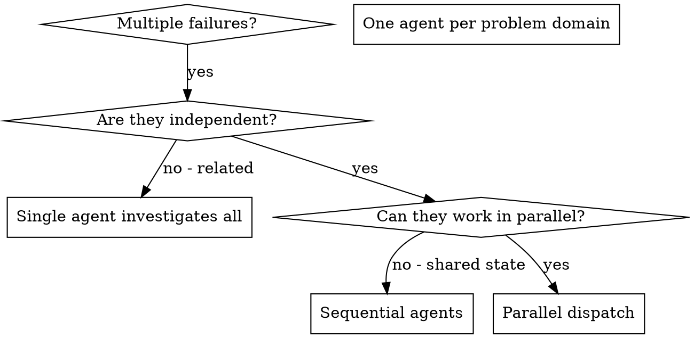

<!-- Ported from obra/superpowers skills/dispatching-parallel-agents/ — MIT License, Copyright (c) 2025 Jesse Vincent. Adapted for DSH. -->

# 并行派发子代理（Dispatching Parallel Agents）

## 总览（Overview）

You delegate tasks to specialized agents with isolated context. By precisely crafting their instructions and context, you ensure they stay focused and succeed at their task. They should never inherit your session's context or history — you construct exactly what they need. This also preserves your own context for coordination work.

（你把任务交给上下文隔离的专职代理。精确构造它们的指令与上下文，它们才能专注并做成。它们**永远不该继承你的会话上下文或历史** —— 需要什么你就只构造什么。这也把你自己的上下文留给协调工作。）

当你有多个互不相关的失败（不同测试文件、不同子系统、不同 bug）时，串行逐个调查是浪费时间：每个调查都是独立的，可以并行发生。

**Core principle: Dispatch one agent per independent problem domain. Let them work concurrently.**

## When to Use



判据只问两件事：
1. 多个失败**独立**吗？（修好一个不会顺手修好另一个；`no - related` ⇒ 单代理统查）
2. 它们**共享状态**吗？（**共享状态 ⇒ 串行**：会互相踩同一批文件、抢同一份资源 —— `no - shared state` ⇒ `Sequential agents`）

**Use when:**
- 3+ 测试文件失败且根因不同
- 多个子系统独立损坏
- 每个问题不需要彼此上下文就能理解
- 调查之间没有共享状态

**Don't use when:**
- 失败相关（修一个可能修好其它）
- 需要理解完整系统状态
- 代理会互相干扰

## 模式（The Pattern）

### 1. Identify Independent Domains

按"坏的是什么"给失败分组：
- File A tests: Tool approval flow
- File B tests: Batch completion behavior
- File C tests: Abort functionality

每个域都是独立的 —— 修好 tool approval 不影响 abort 测试。

### 2. Create Focused Agent Tasks

每个代理拿到：
- **Specific scope:** 一个测试文件或一个子系统
- **Clear goal:** 让这些测试通过
- **Constraints:** 不许改其它代码
- **Expected output:** 找到了什么、改了什么的总结

### 3. Dispatch in Parallel

同一条回复里发出全部派发 —— 它们就并行跑：

```text
subagent: "Fix agent-tool-abort.test.ts failures"
subagent: "Fix batch-completion-behavior.test.ts failures"
subagent: "Fix tool-approval-race-conditions.test.ts failures"
# 三个同时跑。
```

同一条回复里多个派发 = 并行执行。一条回复只发一个 = 串行。

### 4. Review and Integrate

代理回来后：读每份总结 → 核对修复互不冲突 → 跑全量测试 → 合入全部改动。
派发后用 `job_list` 看哪些还在跑，用 `job_output` 收各路结果，不要手工轮询。

## 模型路由与工具（DSH 适配）

- 派发工具：`subagent`（spawn：全新、**不带**会话上下文，正对本模式的隔离语义）；
  只有当子任务确实要接上「本会话已完成的对话」时才用 `subagent_fork`。
- 并行派发的子代理默认走 **`lite` 路由**；但若某个子任务需要多步推理或跨多文件理解，
  **那一路**改用 **`hand`** 路由，其它路照旧。
- **永远不要**用 `lite` 做评审 —— 评审走 **`review`** 路由。
- 记住 *"turn count beats token price"*：便宜模型在多步工作上常花 2–3 倍轮次、总成本反而更高。
  **纯机械、一步到位的才用 `lite`**；判断口径是"这个任务要几步"，不是"这个任务小不小"。

## Agent Prompt Structure

Good agent prompts are:
1. **Focused** - One clear problem domain
2. **Self-contained** - All context needed to understand the problem
3. **Specific about output** - What should the agent return?

```markdown
Fix the 3 failing tests in src/agents/agent-tool-abort.test.ts:

1. "should abort tool with partial output capture" - expects 'interrupted at' in message
2. "should handle mixed completed and aborted tools" - fast tool aborted instead of completed
3. "should properly track pendingToolCount" - expects 3 results but gets 0

These are timing/race condition issues. Your task: read the test file and understand what
each test verifies; identify root cause (timing issues or actual bugs?); then fix by
replacing arbitrary timeouts with event-based waiting, fixing bugs in abort
implementation if found, and adjusting test expectations if testing changed behavior.

Do NOT just increase timeouts - find the real issue.

Return: Summary of what you found and what you fixed.
```

## Common Rationalizations

| 借口 | 现实 |
| --- | --- |
| "先串行查吧，反正也不慢" | 3 个独立故障串行 = 3 倍墙钟；并行是白拿的 |
| "把我的完整上下文都给它，省得写 prompt" | 上下文隔离是本模式的骨架：继承会话 = 制造第二个你，还会互相污染 |
| "这些失败大概有点关系，一起查吧" | "大概"不是判据 —— 花一分钟按问题域分组，独立就并行 |
| "小任务，派个 `lite` 随便跑跑" | 多步任务上 `lite` 轮次翻倍、总成本更高（turn count beats token price） |
| "评审也让干活那个模型顺手看看" | 干活路由不能评审自己；评审永远走 `review` |

## Common Mistakes

**❌ Too broad:** "Fix all the tests" — 代理会迷路
**✅ Specific:** "Fix agent-tool-abort.test.ts" — 范围收敛
**❌ No context:** "Fix the race condition" — 代理不知道在哪
**✅ Context:** 贴上错误信息与测试名
**❌ No constraints:** 代理可能到处重构
**✅ Constraints:** "Do NOT change production code" 或 "Fix tests only"
**❌ Vague output:** "Fix it" — 你不知道它改了什么
**✅ Specific:** "Return summary of root cause and changes"

## When NOT to Use

**Related failures:** 修一个可能修好其它 —— 先一起查
**Need full context:** 理解它需要看到整个系统
**Exploratory debugging:** 你还不知道坏在哪
**Shared state:** 代理会互相干扰（改同一批文件、抢同一份资源）⇒ 串行

## Real Example from Session

**Scenario:** 大重构后 3 个文件共 6 个测试失败

**Failures:**
- agent-tool-abort.test.ts: 3 failures (timing issues)
- batch-completion-behavior.test.ts: 2 failures (tools not executing)
- tool-approval-race-conditions.test.ts: 1 failure (execution count = 0)

**Decision:** 独立域 —— abort 逻辑、batch completion、race conditions 互不相干

**Dispatch:**
```text
Agent 1 → Fix agent-tool-abort.test.ts
Agent 2 → Fix batch-completion-behavior.test.ts
Agent 3 → Fix tool-approval-race-conditions.test.ts
```

**Results:**
- Agent 1: 把任意 timeout 换成事件驱动等待
- Agent 2: 修了事件结构 bug（threadId 放错了位置）
- Agent 3: 加上"等异步工具执行完成"的等待

**Integration:** 全部修复互相独立、零冲突，全量测试绿

## Verification

代理回来后：
1. **Review each summary** — 理解改了什么
2. **Check for conflicts** — 有没有代理改了同一处代码？
3. **Run full suite** — 验证所有修复合在一起仍然成立
4. **Spot check** — 代理会犯系统性错误

## 与 smart 工作流的关系

多个**独立**故障排查并行跑，不要开多个 smart 任务 —— 任务是给『需要把关的交付』用的。
若排查后确实要改码并交付，那才用 `smart_begin({ shape: 'fix' })`。
